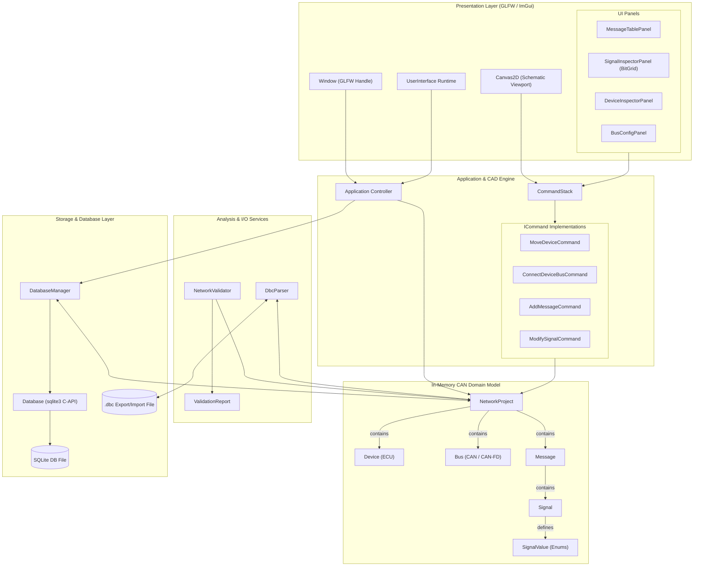
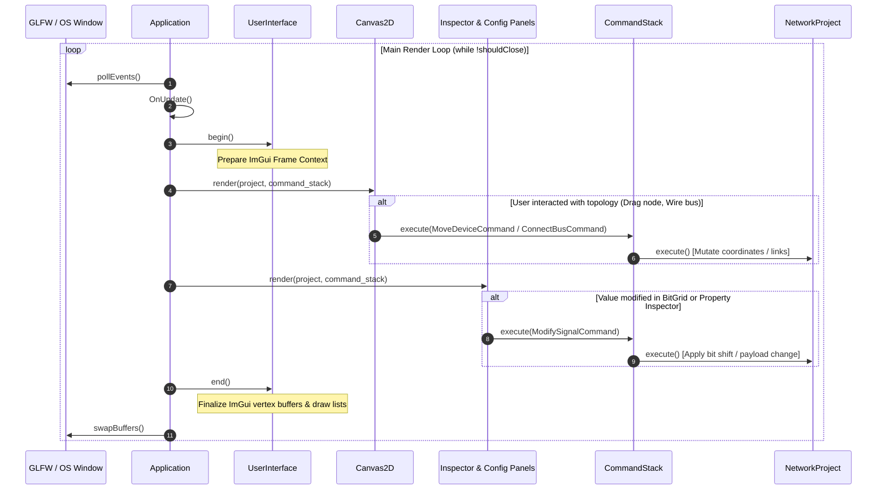
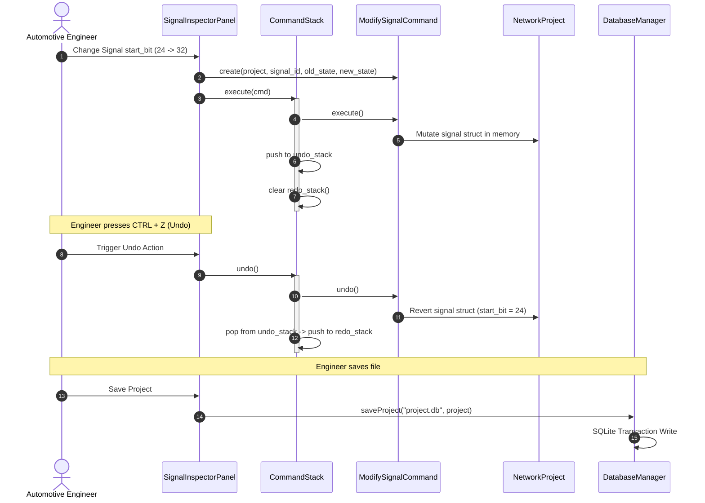
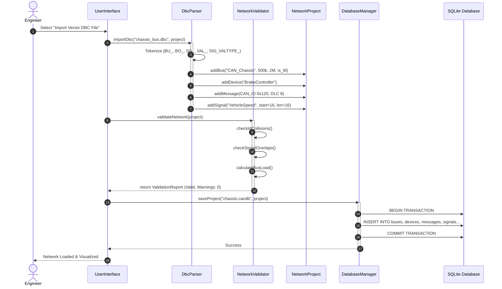
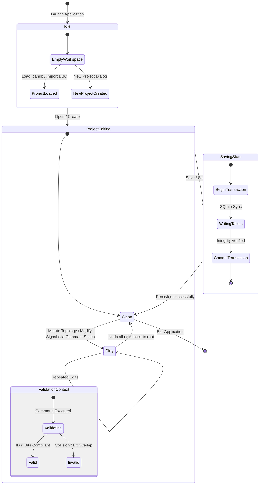

# TODO List
-[ ] Fix Dear ImGui to a commit to prevent breaking changes

## High Level System Diagram

## Application Runtime Loop Sequence Diagram

## Undo / Redo Command Execution Cycle Sequence Diagram

## DBC Input and Validation Pipeline

## Project Workspace Lifecycle Diagram

## [UML Class Diagram](UML.md)
## [ERD Database Diagram](Database.md)