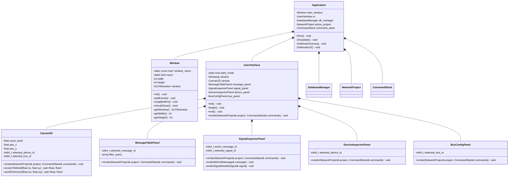
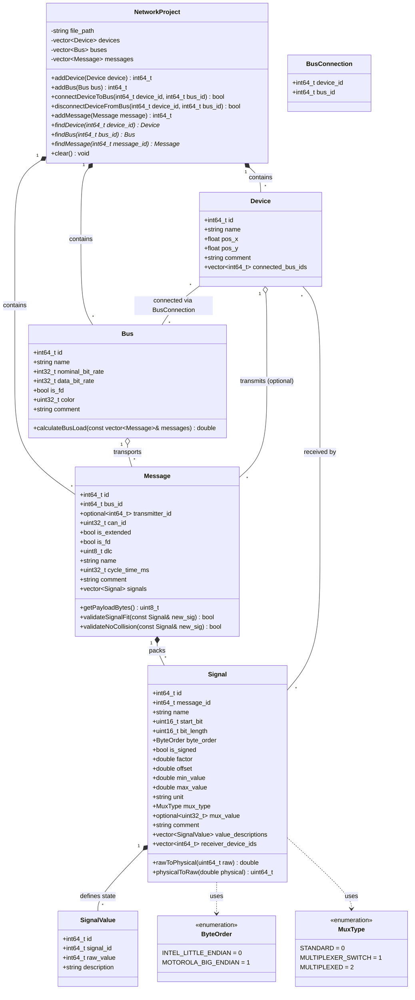
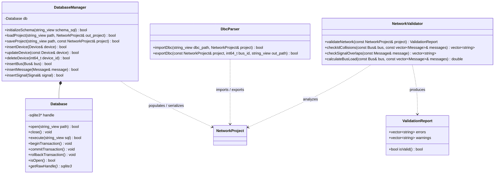
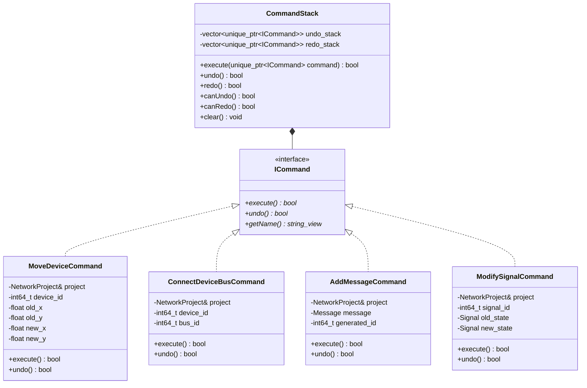

# CAN Network Designer - UML Architecture

---

## 1. System Architecture & UI Subsystem

This diagram models the application runtime, windowing, UI panel composition, and application lifecycle.

---

## 2. CAN Domain Model (Schema Abstraction)

This diagram represents the domain entities mapped directly to [`Schema.sql`](file:///home/rocket/CLionProjects/CAN-Network-Designer/src/Database/Schema.sql).
- A **Bus** carries traffic at defined nominal and data bit rates.
- A **Device** (ECU) connects to one or more buses via `BusConnection`.
- A **Message** belongs to a **Bus** and is transmitted by an optional **Device**.
- A **Signal** belongs to a **Message**, supports bit positioning, multiplexing (`MuxType`), scaling, and can be received by multiple **Devices**.
- A **SignalValue** defines human-readable descriptions for discrete signal states (enums).

---

## 3. Persistence, Database & Services Layer

This diagram abstracts SQLite operations, database lifecycle, DBC file import/export, and network validation against CAN bus physical rules.

---

## 4. CAD Command Pattern (Undo / Redo Architecture)

Professional CAD software relies on an undo/redo command stack for schematic mutations. This pattern decouples UI actions from the domain model and database synchronization.

